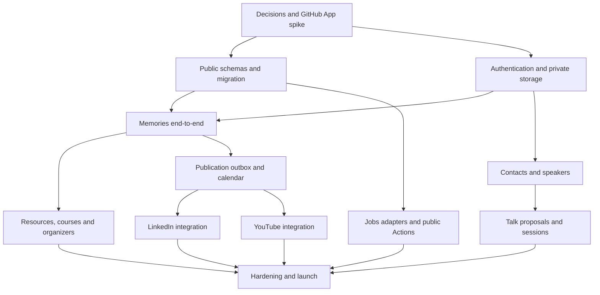

# Delivery roadmap and implementation backlog

Status: planning only. Durations are planning ranges for one experienced full-stack engineer with part-time design/review support, not commitments. Provider approvals, content review and infrastructure procurement can extend calendar time independently of engineering work.

## 1. Delivery sequence

| Phase | Indicative effort | Deliverable | Exit gate |
| --- | --- | --- | --- |
| 0 — Discovery and integration spikes | 3–5 engineer-days | Confirm identity/hosting/source assumptions; GitHub App sandbox; provider capability matrix | Decisions logged; no unproven social capability advertised |
| 1 — Public content contracts | 5–8 days | Schemas, stable IDs, adapters and migration of current content | Same rendered site, validated IDs/media/locales, reversible migration |
| 2 — Admin foundation and Memories slice | 8–12 days | Auth, roles, drafts, media, preview, PR flow, deployment status | Add memory through UI and see reviewed deployed result |
| 3 — Editorial modules and private directory | 8–12 days | Organizers, resources/courses, speakers, events, CRM basics | Public/private projection tests and complete content workflows |
| 4 — Transparent jobs pilot | 7–10 days | Source registry, two adapters, Actions, review and freshness UI | Seven-day monitored pilot; failure/closure rules proven |
| 5 — Community operations and social publishing | 10–15 days | Proposals/sessions, calendar, LinkedIn and YouTube adapters | Actual provider-account smoke tests or explicit manual fallback |
| 6 — Hardening and handover | 5–8 days | Security tests, restore drill, observability, operator runbooks | Release checklist signed off |

Total planning envelope: 46–70 engineer-days before external approval delays. Deliver incremental usable releases; do not wait for YouTube or LinkedIn access before shipping the website editor. Re-estimate after Phase 0 using measured upload behavior and migration complexity.

## 2. Dependency map

Social branches can ship as manual-export mode until external access is ready. Hardening gates apply to each enabled feature; disabled integrations do not prevent earlier release.

## 3. Backlog by epic

### E0 — Decisions and proof of feasibility

- ADM-001: Record app name, repository owner, operators, approval policy, region and cost ceiling. Acceptance: decision log distinguishes confirmed values from defaults.
- ADM-002: GitHub App sandbox installation. Acceptance: scoped app opens one fixture PR, CI runs, webhook receives signed event, and no protected-main bypass is possible.
- ADM-003: LinkedIn capability spike. Acceptance: actual app approval/scopes and organization-role requirements recorded; publish test only to an explicitly approved destination.
- ADM-004: YouTube capability spike. Acceptance: OAuth/channel identity, upload quota and actual visibility restrictions recorded; private controlled upload tested when authorized.
- ADM-005: Select first approved ATS boards. Acceptance: source owner/domain, terms basis, region relevance and public attribution are recorded; no guessed active employers.

### E1 — Schemas and migration

- ADM-010: Versioned JSON schemas and shared TypeScript types. Acceptance: invalid URLs, unknown references, private keys and missing locale fields fail with precise paths.
- ADM-011: Stable IDs and migration tool. Acceptance: dry run plus repeatable export; names are not used as foreign keys.
- ADM-012: Memories extraction. Acceptance: exact current five records and ordering preserved, gallery remains operational.
- ADM-013: Organizer/resources extraction. Acceptance: Josua/Oscar/Ronald mappings preserved; twelve cover illustrations remain keyed to resource identity.
- ADM-014: Speakers/events adapters. Acceptance: existing event pages and structured data remain equivalent.
- ADM-015: CI content validation. Acceptance: root and repository-subpath builds pass for both locales; secret/public DTO checks block unsafe fixtures.

### E2 — Platform and access

- ADM-020: New repository scaffold and local environment. Acceptance: web/API/worker/PostgreSQL/object-store emulator run from documented commands without production credentials.
- ADM-021: GitHub login and invitations. Acceptance: uninvited account denied; revoked user cannot use an existing session.
- ADM-022: Role/capability enforcement. Acceptance: backend tests cover every role mutation boundary.
- ADM-023: Database migrations and audit. Acceptance: reversible non-destructive migration process, append-only audit access and redaction tests.
- ADM-024: Encrypted connector credential storage. Acceptance: raw secrets absent from DB dumps available to ordinary roles, logs, browser network responses and public artifacts.
- ADM-025: Outbox/worker leases. Acceptance: worker crash and replay do not create duplicate local operations.

### E3 — Content editing and GitHub publishing

- ADM-030: Draft list/editor with revision preconditions. Acceptance: concurrent edit returns conflict without losing either version.
- ADM-031: Media uploads and validation. Acceptance: portrait/landscape, oversized image, spoofed MIME and failed checksum handled correctly.
- ADM-032: Authenticated preview and public-boundary warning. Acceptance: draft inaccessible anonymously; submission clearly indicates public PR visibility.
- ADM-033: Revision-bound approvals. Acceptance: edit invalidates approval and cannot be published with stale reviewer decision.
- ADM-034: Atomic Git commit and PR creation. Acceptance: retry returns same PR, allowed files only, public-safe summary.
- ADM-035: PR/check/deployment reconciliation. Acceptance: failed Pages deployment remains failed even after successful merge.
- ADM-036: Conflict resolution and revert PR. Acceptance: same-entity conflict demonstrated and previous public revision restored through review.
- ADM-037: Organizers/resources/course editors. Acceptance: editable fields map to schemas; no raw code editor needed.

### E4 — Private community operations

- ADM-040: Contact and organization directory. Acceptance: search, archive, field-level permissions and audited exports.
- ADM-041: Speaker profile and public projection. Acceptance: private notes/contact fields never appear in generated Git files.
- ADM-042: Import preview and deduplication. Acceptance: dry-run counts, row errors, formula-safe CSV exports and no automatic destructive merges.
- ADM-043: Talk proposals and event participation. Acceptance: proposal state is per event, availability is not treated as confirmation.
- ADM-044: Sessions/agenda. Acceptance: room and speaker overlaps detected; time-zone handling tested.
- ADM-045: Follow-ups and deletion process. Acceptance: reminders remain internal; deletion tombstones survive restore.

### E5 — Jobs ingestion

- ADM-050: Adapter interface and fixtures. Acceptance: complete/incomplete/failed/quarantined results distinguish source coverage.
- ADM-051: Greenhouse adapter. Acceptance: bounded pagination, valid links, source IDs and no authenticated scraping.
- ADM-052: Lever adapter. Acceptance: same contract with provider-specific normalization fixtures.
- ADM-053: Relevance/eligibility and dedup rules. Acceptance: unknown Peru eligibility held for review; cross-source matches remain reversible.
- ADM-054: Freshness/closure reconciler. Acceptance: failure cannot close jobs; two-run missing rule and anomaly threshold tested.
- ADM-055: Public GitHub Actions pipeline. Acceptance: read-only fetch job and scoped write job, redacted run summary, one sync PR and CI trigger verified.
- ADM-056: Job review UI and overrides. Acceptance: exclusions persist across runs; manual content not overwritten by scraper.
- ADM-057: Public job board adaptation. Acceptance: demo labels removed only when real approved data exists; source links, last checks and stale states shown.
- ADM-058: Seven-day pilot report. Acceptance: review relevance precision and closure false positives, monitor source failures, decide whether trusted closure auto-merge is appropriate.

### E6 — Publishing and integrations

- ADM-060: Editorial calendar and reusable drafts. Acceptance: date/zone, event dependency and channel variants visible.
- ADM-061: Connector health/reconnection. Acceptance: revoked credentials block sending and alert operators without exposing tokens.
- ADM-062: LinkedIn text/link/image adapter. Acceptance: correct organization, permission check, stored post ID and safe ambiguous-response handling.
- ADM-063: Manual publication package. Acceptance: copy/media/links export and manual URL recording work without provider access.
- ADM-064: YouTube multipart staging and resumable upload. Acceptance: interrupted transfer resumes; private-by-default request and provider response stored.
- ADM-065: Video metadata/processing and recording-link PR. Acceptance: processing failure cannot appear as published; public video generates a reviewed website link update.
- ADM-066: Scheduling, cancellation and reconciliation. Acceptance: approval changes, missed slots, duplicate intents and revoked actors tested.

### E7 — Release and operations

- ADM-070: Threat-model tests and dependency scanning. Acceptance: no unresolved critical data exposure or authorization defect.
- ADM-071: Accessibility and responsive browser QA. Acceptance: keyboard-only primary workflows, contrast, visible focus, error announcements and reduced motion.
- ADM-072: Metrics, alerts and runbooks. Acceptance: simulated source outage, queue backlog and failed deployment produce actionable alerts.
- ADM-073: Backup restore drill. Acceptance: stated RPO/RTO measured, deleted contacts remain deleted after replaying tombstones.
- ADM-074: Operator onboarding and production checklist. Acceptance: a community operator completes a memory PR and reviews jobs without developer intervention.

## 4. First vertical slice in exact order

1. Freeze a baseline screenshot/data inventory of current Memories.
2. Write schema and invalid-record tests; extract records without changing output.
3. Create invited-user login, private draft storage and a simple memory editor.
4. Implement safe media staging with actual dimensions and bilingual alt text.
5. Render authenticated preview using the site's existing memory renderer contract.
6. Add revision-bound approval and deterministic content export.
7. Open a PR through the GitHub App on a sandbox repository, then the real repository after app setup is approved.
8. Observe checks and merge/deployment webhooks; demonstrate failure and retry.
9. Complete a real approved memory update; compare the public rendering with the preview.
10. Document rollback and prove a revert PR restores the previous version.

Do not start with a dashboard full of disconnected buttons. The first release must complete a real content lifecycle before adding additional modules.

## 5. Definition of done for each implementation PR

- Acceptance criteria referenced by ID; test evidence attached.
- No unreviewed changes to the public website's existing presentation.
- Public/private boundaries reviewed; no secrets or local personal paths in executable configuration.
- Database and content migrations documented with rollback/recovery behavior.
- New endpoints have runtime input/output validation and authorization tests.
- UI states include loading, empty, validation error, permission denial, offline/dependency failure and retry behavior where relevant.
- Documentation in English; public content bilingual; Spanish admin labels reviewed.
- Browser verification for visual changes; unit tests alone do not establish visual correctness.
- Provider operations disabled behind feature flags until connection and approval gates pass.

## 6. Production launch checklist

- Repository and GitHub App installed with confirmed permissions.
- Protected main branch and required checks enforced.
- Admin domain, TLS, OAuth callback URLs and session policy configured.
- PostgreSQL backups and object-storage lifecycle configured and tested.
- Owners and operators invited; role escalation tested.
- Public-content export and CRM redaction tests passing.
- First job sources reviewed; pilot metrics accepted; no demo jobs presented as real.
- LinkedIn/YouTube features accurately reflect actual approved capabilities.
- Operator alert destination configured and tested.
- Rollback and restore rehearsed; emergency connector revoke procedure documented.
- Public site remains functional during simulated admin outage.

## 7. Planning handoff

Next action is Phase 0, followed by the Memories vertical slice. A separate implementation request should authorize creating the application repository and selecting infrastructure. No current website code, production workflow, GitHub App installation, source collection or social publication has been changed by this planning package.
