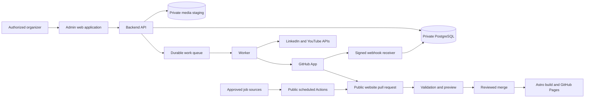

# Platform Engineering Perú — community administration specification

Version 0.1 · Proposed · 8 November 2026

## 1. Purpose and product outcome

Build a separate administration application that allows authorized community organizers to maintain the public website, curate learning resources and jobs, coordinate speakers and sessions, and prepare/publish communications without manually editing application source files.

The public Astro website remains independently deployable and readable when the admin application is unavailable. The admin application must not become a runtime dependency of GitHub Pages. Published content changes must remain understandable and reversible through Git history.

Primary outcomes:

- Add a memory with photos, bilingual captions, event association and accessible descriptions.
- Add or update resources and courses; manage visibility and editorial ordering.
- Update an organizer without mixing the person's name, photograph or illustrated avatar.
- Operate a job board with source attribution, freshness tracking and transparent scheduled collection.
- Prepare LinkedIn page posts and YouTube video publications, track approvals and outcomes.
- Maintain a private directory of speakers, contacts, organizations, talk proposals, sessions and follow-ups.
- See what is drafted, approved, merged, deployed, scheduled, failed or awaiting intervention.

No requirement in this specification authorizes immediate external publication. The current deliverable is a plan; the application will implement explicit publishing controls.

## 2. Existing implementation and migration constraints

The inspected repository uses Astro, TypeScript, local data modules, bilingual `es-pe`/`en` routes, Three.js experiences and GitHub Pages. Existing content locations:

| Capability | Current source | Required adaptation |
| --- | --- | --- |
| Memories | `src/modules/memories/Memories.astro`, `public/memories/` | Extract embedded titles, alt text and descriptions into records; retain ribbon and modal renderers |
| Resources/courses | `src/data/resources.ts` | Introduce stable IDs, structured records, dedicated course fields and explicit cover-art keys |
| Organizers | `src/data/organizers.ts` | Stable IDs, explicit ordering, separate photo/figurine fields |
| Speakers | `src/data/speakers.ts` | Public speaker projection separated from private contact directory |
| Events | `src/data/events.ts` | Replace speaker-name references with IDs through compatibility adapters |
| Jobs | `src/data/opportunities.ts` | Replace demonstration vacancies with verified records and real application links |
| Site configuration | `src/data/site.ts`, locale modules | Curated, typed editable fields only; no arbitrary code or CSS editing |
| Branding | `public/brand/` | Asset inventory and approval metadata; preserve original logo and official derivatives |
| Deployment | `.github/workflows/deploy.yml` | Keep main-branch Pages deployment and daily refresh; extend with content validation |

Current deployment includes a scheduled build at 05:10 UTC (00:10 Lima). This rebuild alone does not collect jobs. A distinct job-ingestion workflow is required.

Migration rules:

1. Do not let the admin write executable TypeScript supplied by users.
2. Move editable content to versioned JSON with JSON Schema; preserve typed adapters so current components need minimal changes.
3. Use one JSON file per entity to reduce Git conflicts. Use explicit ordering fields, not array position as identity.
4. Move memories first as the smallest vertical slice, then organizers, resources/courses, events/speakers, jobs.
5. Compare rendered output before/after each extraction. Preserve route slugs, translations, layout, animation hooks, asset paths and structured-data behavior.
6. Keep original media and the approved logo. Asset replacement is a versioned operation with preview and rollback.
7. Capture the current reference commit at implementation kickoff; this plan does not assume the open PR has already merged.

## 3. Scope and release boundaries

### First usable release

Authentication, roles, content listing and editing, media upload, bilingual validation, changeset previews, GitHub PR creation/status, memories, organizers, resources/courses, private contact/speaker records, audit trail, source configuration and job collection pilot.

### Subsequent releases

Sessions and event coordination, editorial calendar, LinkedIn API publishing, YouTube resumable uploads, publication reconciliation, richer reporting and optional permitted source adapters.

### Explicitly excluded initially

A public social network, member passwords on the static site, course hosting/LMS, candidate applications/CV storage, payment processing, private-message automation, automated invitations, unrestricted scraping, a general-purpose website builder, mass contact harvesting, an AI system that publishes without review, and guaranteed publication at an exact second through GitHub Actions.

Adding a course initially means a curated link with learning metadata, not hosting lessons or tracking student progress.

## 4. Users, permissions and approval policy

Permission checks occur in backend services on every operation. UI hiding is supplementary. Roles are composable scopes; the first release may expose these predefined bundles:

| Role | Capabilities | Restrictions |
| --- | --- | --- |
| Viewer | Read public content inventory and redacted operational status | No CRM access by default, no writes |
| Editor | Create/revise drafts, upload media, submit changesets | Cannot merge, publish externally or connect providers |
| Content reviewer | Approve/reject content revisions, request changes | Cannot approve an older revision after content changes |
| Publisher | Merge approved website changes and approve/schedule external posts | Must satisfy branch rules and approval policy |
| Community coordinator | Read/edit permitted private contacts, speakers, sessions and follow-ups | Cannot export all contacts without export permission |
| Jobs curator | Review sources, candidates, closures and exclusions | Cannot add executable scraping code through the UI |
| Owner | Manage invitations, roles, integrations and policy | Destructive actions and exports are audited |

An owner may hold multiple roles. Default policy requires a reviewer other than the draft author for external posts and sensitive public profile changes. A documented single-maintainer mode may be enabled by an owner; self-approval then remains explicit and audited, never silently granted.

GitHub authorization and admin authorization are separate. An app installation allows server operations on a repository; it does not make every GitHub user an admin. Account linking uses provider subject IDs, never email alone. Deactivated users lose sessions and pending publishing authority immediately.

## 5. Information architecture and interaction design

Use the existing brand palette, typography and restrained visual language. The administration interface prioritizes legibility and operational clarity over decorative motion. Ukuku can support empty states and onboarding without obscuring controls.

Navigation:

- Overview: review queue, deployments, upcoming events, stale sources, scheduled posts, outstanding tasks.
- Website: Memories, Resources, Courses, Organizers, Events, Public speakers, Brand assets, selected Site settings.
- Jobs: Candidates, Published, Expiring/unknown, Sources, Collection runs, Exclusions.
- Community: Contacts, Organizations, Speakers, Talk proposals, Sessions, Follow-ups.
- Publishing: Calendar, Drafts, Approvals, LinkedIn, YouTube, Publication history.
- Operations: Changesets, Pull requests, Deployments, Audit, Integrations, Members and roles.

Standard content editor:

1. Header identifies entity, draft revision and last saved time.
2. Tabs separate content, media, metadata, translations and history.
3. Spanish/English completion indicators identify missing required fields.
4. Autosave writes private drafts after 800 ms idle; it does not create Git commits.
5. Save status distinguishes saving, saved, offline, conflict and validation failure.
6. Preview displays the public rendering; a structured change summary shows additions, edits and removals.
7. Submit for review freezes a revision hash. Further edits create a new revision and invalidate previous approval.
8. Publication timeline shows PR opened, checks pending, approved, merged and deployed as separate steps.

Lists support search, filters, archived records, sortable columns and cursor pagination. Bulk changes show affected counts and require a preview. Destructive deletion defaults to archive; permanent deletion is restricted to a separate owner workflow. All fields have keyboard-accessible labels and inline validation. Mobile supports reviewing and basic editing; full video management may favor desktop but must remain operable.

## 6. Content workflows

### 6.1 Memories

Fields: stable ID, slug, localized title/description, media IDs, alt text per locale, optional event ID, optional known capture date/year, tags, sort order and publication state. Never infer the actual event date from a WhatsApp filename. A year-only record stores year precision, not a fabricated day.

Upload one or more photos, inspect dimensions, strip location metadata from public derivatives, choose ordering, add alt text and preview portrait/landscape layouts. The default public rendering uses contain-fit; cropping is an explicit editorial choice stored as focal-point metadata. Public photos must never rely on the admin storage URL or expiring links.

Each media item's rights record records uploader, source, permission basis and any takedown restriction privately. The public projection contains credit only when intended for publication. Removing a person/photo from the public site creates a removal PR; separately address retained originals, caches and repository history according to the incident policy.

### 6.2 Resources and courses

Shared fields: title, description, topic, content language, external URL, type, cover art key, provider, tags, status, ordering and last link check. Preserve supplied external URLs rather than inventing them. Validate HTTP/HTTPS and detect duplicate canonical URLs.

Courses additionally support level, prerequisites, duration minutes (nullable), delivery format, price model (`free`, `paid`, `unknown`), optional currency/amount, provider and certificate information. Unknown price is not treated as free. Translated descriptions describe the linked course accurately; content language remains separate from interface language.

Cover illustration assignment is explicit by stable key and independent of filtered array position. Editors select from approved illustrations; they cannot inject SVG scripts.

### 6.3 Organizers and public speakers

Maintain public profile fields separately from private contact details. Organizer `displayOrder` defaults to the current ordering with Josua first. Updating a name must not change the identity mapping to photo/figurine. Require all referenced media to exist and preview both navbar-independent profile and organizer carousel views.

A private speaker can have a separately approved public projection. Never serialize the entire private contact object into the website. Public affiliation/role changes require confirmation from a responsible curator; private relationship notes are not public biography material.

### 6.4 Events and sessions

Events store start/end instants with `America/Lima` or an explicit IANA zone, venue, modality, registration link and public status. Sessions reference event IDs and speaker IDs. Existing date/time fields are supported through adapters during migration.

Talk proposals track title, abstract, language, topic, duration, audience level, format, equipment needs, review state and availability. Confirmed sessions add room, schedule and recording permissions. Detect overlapping assignments for the same speaker/room. Generate a proposed agenda; never assume a speaker is confirmed from a contact record alone.

## 7. Architecture and sources of truth

Recommended implementation shape, subject to a short technical spike:

- TypeScript monorepo for the new application, with React web client, a TypeScript HTTP API, shared schema package and Node worker.
- PostgreSQL as transactional store for users, drafts, CRM, approvals, runs and an outbox-backed queue. Start with a PostgreSQL-backed worker queue to avoid an unnecessary Redis dependency.
- S3-compatible private object storage for media staging and video uploads. Public website images are exported as immutable assets into the website repository for the MVP.
- Containers for API/worker and static web-client hosting behind the same origin. Managed PostgreSQL recommended; provider choice remains open until budget, region and operational ownership are agreed.
- OpenAPI 3.1 contracts; JSON Schema for exported public content. Runtime validation at every trust boundary.
- Dependency versions selected and locked at implementation kickoff after compatibility testing, not inferred from the existing website's dependency versions.

Data authority:

| Data | Authority | Replicas |
| --- | --- | --- |
| Published website content | Website repository main commit | Admin read model and deployed website |
| Unpublished drafts/reviews | Private database | Preview artifacts, with access controls |
| Contacts/private sessions/notes | Private database | Encrypted backups only |
| Media before publication | Private object store | Temporary worker files |
| Public media after merge | Versioned website assets | Pages/CDN caches |
| Social publication identity/status | Provider response, reconciled locally | Private publication log |
| Job extraction evidence | Approved source response and run metadata | Redacted normalized snapshot in public Git |

Read models are rebuilt from Git when drift occurs. Editing source files manually remains supported: webhooks import changes and invalidate conflicting drafts. Do not implement dual authoritative writes between Git and PostgreSQL for published content.

## 8. GitHub integration and publication consistency

Install a GitHub App on the website repository only. Proposed repository permissions: contents read/write for approved data/assets paths, pull requests read/write, checks/actions/deployments read for status; actions write only if a deliberately supported dispatch endpoint requires it. GitHub permissions are repository-wide, so application-level allowlists are mandatory. No workflow-file or repository-administration write capability is needed for normal content editing.

Use short-lived installation tokens server-side. Store the signing key in a secret manager; never send it or installation tokens to the browser. GitHub documents installation authentication and repository-scoped access in its [installation authentication guide](https://docs.github.com/en/apps/creating-github-apps/authenticating-with-a-github-app/authenticating-as-a-github-app-installation).

Changeset algorithm:

1. Read current main SHA and relevant file/blob SHAs.
2. Validate the approved draft revision against the current schema and media inventory.
3. Build a deterministic file set containing public fields only. Enforce path allowlists, file-count and byte limits.
4. Create one Git tree/commit with all entity changes and assets atomically; never create a partially updated organizer across separate commits.
5. Create branch `content/<changeset-id>` and PR with a public-safe summary, entity IDs and migration/schema version.
6. Record branch, head SHA, PR number and approval hash in the private database.
7. Receive signed webhooks; deduplicate by delivery ID and reconcile with GitHub API.
8. Allow merge only after required checks and applicable review rules. A reviewer cannot bypass repository protection through the admin UI.
9. On merge record `mergedSha`; on successful Pages deployment of that SHA record `deployedSha`. Display links to both PR and deployment.

Conflict policy: compare base entity version with current main. Independent files may be rebased after validation. Changes to the same entity produce a three-way diff and explicit resolution. Deleted records referenced by an event/session cause validation errors, not silent removal. If the PR is manually closed, the draft remains recoverable. If GitHub is unavailable, drafts save normally and publication is queued with visible failure state.

Changeset idempotency is keyed by community ID, changeset ID and approved revision hash. Retries find the existing branch/PR; they do not open duplicates. Merge or deployment failures never roll back unrelated Git commits. Rollback creates a revert PR targeting the affected content version.

Preview design: build the target website commit with the proposed content in a restricted ephemeral environment. Private drafts must not appear in public GitHub artifacts before submission to a public PR. The initial release may offer authenticated local rendering plus screenshots; full branch previews require hosting with authenticated access. Public PR content is public from submission, even before merge: warn clearly at that boundary.

## 9. Public job board and collection pipeline

### 9.1 Source strategy

Prefer documented employer ATS APIs and feeds over HTML extraction. Initial adapter candidates are Greenhouse and Lever, configured for approved employer boards. Their documentation provides public job-listing interfaces; availability of an endpoint is not blanket permission for redistribution. Record source terms/attribution and reviewer approval before enabling each source. See [Greenhouse Job Board API](https://docs.greenhouse.io/job-board.html) and [Lever postings API](https://github.com/lever/postings-api).

Do not scrape LinkedIn jobs, authenticated sessions, CAPTCHA-protected pages or personal profiles in the initial release. HTML adapters require a source-specific review, robots policy check, conservative rate limits and fixtures. Do not bypass blocks or use rotating identities to evade controls. The app manages source configuration; adapter code changes require ordinary code review.

### 9.2 Relevance and eligibility

Include Platform Engineer, SRE, Developer Experience, platform product and relevant cloud infrastructure/DevOps roles. Use deterministic weighted rules based on title, description and explicit location eligibility. Configurable initial threshold: title match 3 points, relevant duties 2, each confirmed platform skill 1 (cap 3); review candidates at 4+. Threshold is a pilot configuration, not a quality guarantee.

Exclude unrelated sales/recruitment roles and obvious scams. A remote label alone does not prove Peru eligibility. Location states: `peru`, `remote-peru`, `remote-latam-confirmed`, `restricted`, `unknown`. Unknown eligibility requires curator review. Store original language and source title; translations are derived editorial summaries, labeled accordingly. Do not infer salary, seniority or sponsorship where absent.

### 9.3 Schedule and transparency

Proposed schedule: `17 12,21 * * *` UTC, corresponding to 07:17 and 16:17 Lima. Run on the default branch plus restricted manual dispatch. Public workflow source, normalized public snapshots, source registry, PR diffs and redacted run summaries provide transparency.

Scheduled Actions can be delayed and are not a precise scheduler. Display actual `lastSuccessfulFetchAt`, not the intended cron time. GitHub documents scheduling behavior and default-branch constraints in [workflow events](https://docs.github.com/en/actions/reference/workflows-and-actions/events-that-trigger-workflows#schedule).

Public summary includes run ID/URL, schema/rules version, adapter versions, source IDs, started/finished times, counts of fetched/new/changed/closed/quarantined records and sanitized failure codes. Do not publish tokens, HTTP authorization headers, personal emails, entire HTML pages or private recruiter notes. Public normalized job data includes minimal factual fields, source link and collection timestamps; full third-party text is not copied by default.

### 9.4 Processing steps

1. Load reviewed registry and last-known-good snapshot from main.
2. Fetch each source with timeout, bounded pagination and rate limit; validate host and redirects against allowlist.
3. Parse to a typed normalized record, sanitize text and remove tracking parameters from links while preserving functional parameters.
4. Deduplicate by `(sourceId, externalId)`; use canonical URL as secondary identity. Cross-source matching uses normalized employer/title/location as a suggestion, not automatic destructive merging.
5. Classify relevance and location eligibility; quarantine malformed or suspicious entries.
6. Compare with previous snapshot only for sources whose complete pagination succeeded.
7. Apply freshness/closure rules and preserve manual exclusions and curator overrides.
8. Produce a deterministic candidate snapshot and run summary. Sort stable IDs; ignore fetch-only timestamps when deciding whether a content PR is needed.
9. Open or update a single `content/jobs-sync` PR. Any changed content invalidates prior approvals. Update the latest source evidence without overwriting manual curated fields.
10. CI validates schemas, links, policy thresholds and renders the public job board. Approved merge triggers normal Pages deployment.

Default mode: new jobs and material changes need a Jobs curator review. After a monitored pilot, trusted sources may auto-merge narrowly scoped closure/freshness changes if required checks pass and repository policy allows. Do not auto-merge workflow changes, new domains, salary edits or mass removals.

### 9.5 Status model and failure semantics

Job states: `candidate`, `active`, `needs-review`, `stale`, `closed`, `excluded`. Publication approval is separate from observed source status.

- `active`: source explicitly lists the job on a complete successful fetch and eligibility has been approved.
- `closed`: source explicitly marks closed, known expiry passes, or job is absent from two complete successful source snapshots at least 12 hours apart.
- `stale`: no successful verification for 72 hours; exclude from the default active view and show last verification in an optional stale view.
- Source timeout, 403, 429, parse error, interrupted pagination or abnormal empty response never closes every job.
- A source returning zero after previously returning jobs, or a proposed removal of more than 30% of its active jobs, requires quarantine and human review even if HTTP is 200.
- Source recovery resets freshness; a previously closed job that reappears becomes a review candidate unless the source identity confirms reopening.
- Manual exclusions use stable source IDs and survive future collection. Curator fields and extracted fields have distinct ownership.

Public UI states “Listed by source; checked at …”, not “guaranteed available.” Applications go to the original employer URL; no applicant data is collected. If all sources fail, retain last-known-good content with freshness warnings. A static-site outage or delayed deployment must remain visible through a collection-health timestamp; optional client-side freshness labels can be computed from the published timestamp without needing the admin backend.

### 9.6 Workflow security and reproducibility

Use two jobs. Fetch/parse job has read-only contents permission and no publication secret. It uploads only a schema-valid normalized artifact plus checksums and provenance. A separate publish job on a trusted default-branch workflow validates the artifact again and receives scoped GitHub App credentials. Never execute downloaded HTML/scripts. Avoid `pull_request_target` for running untrusted code. Actions are pinned to SHAs; manual inputs are enumerated source IDs, not commands/URLs.

Use concurrency `jobs-sync`, `cancel-in-progress: false`, and one PR branch to prevent racing writes. Bound each source to 2 concurrent requests, 15-second request timeout, 3 transient retries with jitter, 100 pages and 2,000 records initially; a cap hit marks the source incomplete. Workflow timeout: 20 minutes. Configure limits per source only after review.

Use a GitHub App token to create/update the content PR so subsequent CI is triggered as intended; do not assume events produced with the built-in `GITHUB_TOKEN` will trigger other workflows. Validate this in an end-to-end repository fixture before rollout. Keep private CRM and social credentials out of this workflow entirely.

## 10. Private community directory

Entities: Person, Organization, ContactPoint, SpeakerProfile, Topic, Interaction, Task, TalkProposal, Session, EventParticipation and ConsentRecord.

Person holds preferred name, optional pronouns, location/time zone, languages, organization affiliation and private notes. ContactPoint supports email, phone and professional profile URL with visibility, provenance and last verification. SpeakerProfile includes topics, formats, public bio candidate, travel/remote preferences, availability notes and experience links. Sensitive preferences are optional and permission-restricted.

Interaction records channel, date, author, summary and follow-up due date. It does not send a message. Outreach execution is out of scope until separately configured and authorized. CSV import provides dry-run mapping, duplicate suggestions and row-level errors; CSV export requires permission, is audited and neutralizes spreadsheet formula injection.

Directory lifecycle: prospect → contacted → interested → proposed → confirmed → participated → follow-up, with optional declined/inactive. Do not equate pipeline status with consent to publish. The same person may hold different states for different events; store status on participation/proposal relations, not only on Person.

Public speaker export includes only approved name, bio, photo, selected links and affiliation. Emails, phones, internal notes, availability, compensation, relationship scores and invitation history never enter Git. Default exports omit contact points. A deletion request triggers review of database records, object storage, backups and any already public projection.

Proposed retention policy for owner review: recheck inactive prospects after 12 months; delete unneeded private notes after 24 months; revoke integration tokens immediately on disconnect; retain public Git history as publication history. Backup expiration and restoration procedures must reapply deletion tombstones to prevent deleted contacts reappearing. This is a product retention proposal, not a legal compliance determination.

## 11. LinkedIn publishing

Target the Platform Engineering Perú organization page first. Personal-account publishing is a separate capability, off by default. Connect through OAuth using the official provider flow, verify the selected organization and the actor's publishing authority, and expose the granted scopes and account identity.

Use LinkedIn Posts API for supported text, article/link and image posts; video publishing can be a later extension. Store the API version in configuration and monitor its retirement. Provider documentation confirms post types and permission requirements; access must be approved/configured for the actual app. See [Posts API](https://learn.microsoft.com/en-us/linkedin/marketing/community-management/shares/posts-api) and [Community Management overview](https://learn.microsoft.com/en-us/linkedin/marketing/community-management/community-management-overview).

Composer fields: organization, campaign/event reference, language, text, link, media, alt text where supported, publication time and reviewer. Preview is an approximation; do not imply exact native layout. Validate provider-supported limits against the selected API version rather than freezing undocumented limits in the design.

Publication states: draft → review → approved → scheduled → sending → published / failed / unknown. Approval binds content hash, media IDs, channel and destination. Editing any of these revokes approval. At send time verify account permission, token validity, schedule and that the referenced website content is actually deployed if the campaign depends on it.

Persist provider post ID and URL. On timeout after submission, reconcile before retrying; provider operations may not support idempotency. An ambiguous result becomes `unknown` and needs a read-back or manual resolution, not automatic duplicate posting. Retry rate limits/transient failures with bounded backoff. Invalid authorization becomes `needs-reconnection`.

If app access is denied or unavailable, allow a downloadable publishing package with copy, images and links. A user can publish manually and record the resulting URL. Label this mode clearly; it is not API automation. Do not automate a logged-in browser as an API substitute.

## 12. YouTube publishing

“Publish to YouTube” means upload/manage videos, titles, descriptions, thumbnails, playlist associations and visibility where the connected account and API permit. Community-tab text/image posts are not promised; do not treat them as video uploads.

Use user OAuth for the actual channel owner/manager. Never assume a general service account can upload to an ordinary community channel. Request the narrowest scopes needed by enabled operations and store refreshed credentials only in the backend secret store.

Upload flow:

1. Create private video draft with title, localized editorial description, language, channel, session reference, recording consent and desired visibility.
2. Upload directly from browser to private storage using short-lived multipart URLs; do not route multi-GB uploads through the API process.
3. Validate checksum, file signature, media metadata and storage quota. Default application limit: 5 GB per file, configurable after infrastructure testing; this is not the provider's maximum.
4. Worker starts resumable upload, persists resumable-session state privately and resumes interrupted transfers.
5. Upload as private initially. Persist returned video ID before updating any additional metadata.
6. Poll processing with backoff, surface processing failure, and apply thumbnail/playlist/captions only when supported and approved.
7. Publish or schedule only the approved revision. Record actual provider visibility, publication time and canonical URL; then optionally create a website recording-link PR.

YouTube's current upload documentation describes upload behavior and quotas. These requirements have changed over time, so project audit/verification, quota and visibility eligibility must be checked against the actual Google Cloud project before launch. Do not hard-code a historical quota cost or assume public upload entitlement. See [videos.insert](https://developers.google.com/youtube/data/reference/rest/v3/videos/insert).

If uploading is not available, support linking an existing video and exporting prepared metadata for YouTube Studio. The UI must distinguish queued upload, uploaded/private, processing, scheduled and public. Public completion requires a provider-confirmed video, not only a successful request to the worker.

## 13. Scheduling, background work and reliability

GitHub Actions handles public job collection and website deployment. A private durable worker handles social schedules, GitHub changeset creation, media validation and reconciliation. Do not place CRM exports, refresh tokens or social publication payloads in public Actions logs/artifacts.

Use transactional outbox: the API transaction saves the approved operation and outbox event; workers claim events with leases and heartbeat, then write attempt outcomes. Uniqueness constraints enforce one local publication intent per `(channel, destination, contentRevision, scheduledSlot)`. Exactly-once external delivery cannot be guaranteed; reconciliation handles ambiguous outcomes.

All stored instants are UTC; UI defaults to America/Lima and shows explicit zone on scheduling. Store the requested local time and IANA zone alongside the resolved instant for audit. A missed schedule beyond 30 minutes moves to review unless an owner-configured grace policy allows late publication. Cancellation works while queued; after provider submission it becomes a separate removal/unpublish request with outcome tracking.

Concurrency: one send per provider account initially; video upload concurrency one per channel. Retry transport/5xx failures at most 3 times with exponential jitter; honor Retry-After. No retries for invalid content or revoked permissions without a change. Dead-letter items appear in Operations with a safe retry action.

## 14. Security and data protection

- Session cookies: HttpOnly, Secure, same-site policy appropriate to OAuth, bounded idle/absolute expiry and server-side revocation. CSRF protections for state-changing requests; OAuth state/PKCE as applicable.
- All authorization enforced server-side; test horizontal access and ownership boundaries even in single-community mode.
- Tokens encrypted at rest with keys outside the database. Logs redact tokens, emails, phones, upload URLs and raw provider responses containing private data.
- Webhooks verify signatures over raw request bytes, reject stale/replayed events and handle out-of-order deliveries.
- SSRF defense for links/media/source fetches: HTTPS allowlist, DNS/IP validation including redirects, block private/link-local/metadata networks, cap response size and time.
- Uploaded images are decoded and re-encoded; validate actual type, dimensions and decompression limits. Do not serve untrusted SVG/HTML from the admin origin. Scan staged files and quarantine failures.
- Public export uses an explicit DTO allowlist, never object spreading from CRM records. CI scans exports for forbidden keys and secret patterns.
- Content text is escaped; any Markdown uses a restricted renderer with raw HTML disabled. No arbitrary scripts, CSS or iframe embeds through the editor.
- Audit records actor, action, entity, before/after revision hashes, correlation ID, approval identity and outcome. Private values are redacted in general activity views.
- Owner actions for role changes, connector reassignment and contact export require recent authentication and an explicit summary.
- Backups are encrypted, access-limited and restore-tested. Production secrets never appear in preview environments.

Threats to test: malicious source HTML, image bombs, modified GitHub webhook payloads, external URLs to internal services, stolen refresh tokens, publication retries causing duplicates, editor escalating to publisher, CRM fields leaked into public PRs and stale approvals reused after edits.

## 15. Operations, performance and cost controls

Proposed initial scale envelope: 10 active operators, 10,000 public content records, 5,000 contacts, 50 job sources, 20,000 normalized job records and 100 GB staged media. These are engineering test targets, not observed usage. Configure quotas before enabling uploads.

Targets under that envelope: ordinary list/read p95 under 500 ms server time, draft-save p95 under 750 ms, search under 1 second, queued operation acknowledgement under 1 second. Long provider operations return 202 plus operation ID. Website performance must not regress from loading admin code or fetching admin APIs.

Operational signals: save failure rate, queue age, provider error/rate-limit counts, jobs last-success by source, PR check failures, merge-to-deploy latency, storage growth and backup age. Alert on failed scheduled collection twice consecutively, no successful collection for 24 hours, worker backlog over 15 minutes, repeated invalid OAuth, and failed deployment. Deduplicate alerts; display them in-app and use a separately configured operator destination.

Recovery targets proposed: private database RPO 24 hours and RTO 4 hours for the pilot; evaluate point-in-time recovery for production. Restore drills quarterly and before the first production launch. Git-based public content can be rebuilt independently. A revoked connector stops only that integration.

Cost model to measure during the spike: web/API compute + worker uptime + managed database + object storage + upload/download egress + backup retention + preview builds. No monetary quote is asserted without a provider/region and observed workload. Apply per-file, per-user and total-storage caps; expire abandoned uploads after 7 days and failed previews after 48 hours. Keep large videos out of Git.

## 16. Verification and acceptance

| ID | Scenario | Required result |
| --- | --- | --- |
| AC-01 | Invited editor signs in; uninvited GitHub user signs in | Editor gets assigned capabilities; uninvited user denied |
| AC-02 | Add memory with portrait and landscape photos | Both locales render complete images, alt text and approved order |
| AC-03 | Change organizer role/photo | Correct stable identity remains bound to name, figurine and links |
| AC-04 | Add course | Schema and URL valid; course appears in correct filter without code edits |
| AC-05 | Submit approved draft twice | Exactly one changeset branch/PR for the revision |
| AC-06 | Main changes same entity during edit | Conflict surfaced; no silent overwrite |
| AC-07 | PR merged but Pages fails | UI says deployment failed, not published |
| AC-08 | Collector receives 429/empty abnormal result | Previous jobs retained; source marked degraded; no bulk closure |
| AC-09 | Job absent from two complete runs ≥12h apart | Closure candidate with evidence and correct timestamps |
| AC-10 | New source response contains HTML script or private URL | Sanitized/rejected; no execution or internal-network request |
| AC-11 | Export speaker to public site | Only approved public fields leave private store |
| AC-12 | Edit approved LinkedIn post | Approval invalidated and scheduled send blocked |
| AC-13 | LinkedIn request times out after remote success | Unknown/reconciliation path; no blind duplicate |
| AC-14 | YouTube upload interrupted | Resumes or recovers state without claiming publication |
| AC-15 | Provider access unavailable | Manual export mode works and clearly identifies manual steps |
| AC-16 | Restore private backup | Drafts/CRM recover; deletion tombstones reapplied |
| AC-17 | Migrate existing website data | Stable routes, organizer mapping, branding and animations retained |
| AC-18 | Public jobs run inspected by visitor | Sources, times, counts and change PR traceable; secrets/private CRM absent |
| AC-19 | Keyboard/mobile/reduced-motion use | Editors, dialogs, previews and review actions remain usable |
| AC-20 | Cancel queued post or deactivate actor | Worker rechecks eligibility before send and blocks revoked intent |

TDD layers: pure schema/rule tests; repository and database integration tests; mocked provider contract tests; controlled live connector smoke tests; browser end-to-end workflows; visual regression on public rendering; security boundary tests; backup/restore rehearsal. Tests must cover failure paths, not only happy-path snapshots.

Release gate: all mandatory acceptance scenarios for the enabled phase pass; no known private-data export defects; role matrix verified; rollback rehearsed; actual provider connections tested; source permissions recorded; owner receives a runbook and known limitations. Optional integrations stay disabled until their own gates pass.

## 17. Open decisions and external dependencies

Before implementation: confirm app/repository name, operator roster, approval model, hosting region/budget, initial job employers, geographic scope and whether “sessionals” means sessions or a specific provider. Before social launch: confirm LinkedIn organization ID, YouTube channel, API access, project verification requirements and who approves posts. Before CRM import: confirm fields, provenance, retention owner and public-profile consent process.

These decisions do not block authoring the specification. They do block provisioning billable services, publishing posts, importing private directories or enabling unreviewed collection sources.
